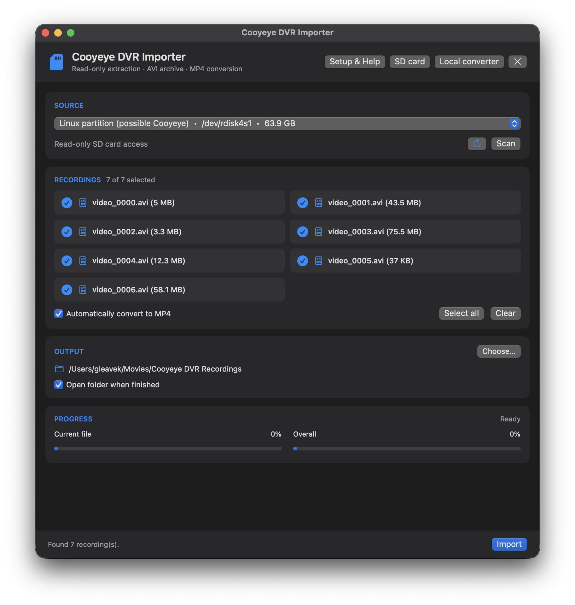
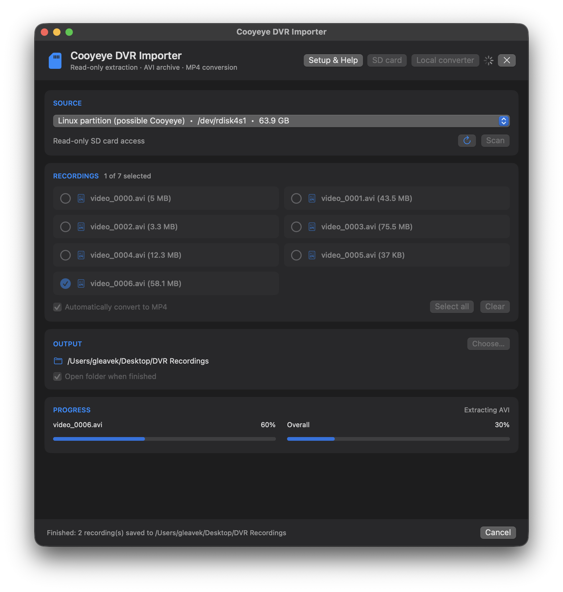

# Cooyeye DVR Importer for macOS

<!-- KRIS-SUPPORT-START -->

> **❤️ Support Free FPV Software Development**
>
> My applications are free and open source. If you find them useful,
> optional contributions help support continued development.
>
> ❤️ **[Become a GitHub Sponsor](https://github.com/sponsors/krisgleave)** — Monthly or one-time support
>
> ☕ **[Buy Me a Coffee](https://buymeacoffee.com/krisgleave)** — Quick one-off contribution
>
> All applications remain free for everyone.

<!-- KRIS-SUPPORT-END -->

**Import high-quality analogue FPV recordings from Cooyeye DVR SD cards directly on your Mac.**

Cooyeye DVR Importer is a free macOS application I created to solve a frustrating problem: my Cooyeye DVR records excellent analogue FPV footage to a microSD card, but macOS won't mount the card normally.

This application lets you access those recordings without reformatting the card, extract the original AVI files, and optionally convert them to MP4 for editing or sharing.

## Screenshots

### 1. Select your recordings

Choose individual AVI files, select all recordings, enable optional MP4 conversion, and choose your output folder.

### 2. Import your recordings

Monitor extraction and conversion using the individual file and overall progress indicators.

## Why I created this

I fly analogue FPV using an ImmersionRC RapidFire receiver installed in my iFlight Skyviz goggles.

Although the Skyviz goggles have a built-in DVR, I experienced two issues:

- **Overheating:** The goggles became particularly hot when using their internal analogue recording functionality.
- **Recording quality:** The built-in DVR's recording quality and 30fps capture weren't giving me the results I wanted.

I wanted a way to record my analogue flights at a higher frame rate without relying on the goggles' internal DVR.

That's where the Cooyeye DVR came in.

## What is the Cooyeye DVR?

The Cooyeye is a compact standalone DVR board that can record video from an analogue receiver directly onto a microSD card.

Rather than relying on the goggles' internal recording system, I connected the Cooyeye directly to the video output of my RapidFire receiver.

This allows the DVR to capture my analogue flights independently, while I continue using the goggles normally.

### Recording specifications

| Feature | Recording details |
|---|---|
| Video codec | H.264 |
| PAL resolution | 960 × 768 |
| PAL frame rate | 50fps |
| NTSC resolution | 960 × 640 (advertised) |
| NTSC frame rate | 60fps (advertised) |
| Advertised video bitrate | Adjustable, 5–20 Mbps |
| Audio | AAC |
| Recording container | AVI |
| Storage | microSD card |

My tested PAL recording was confirmed as **960 × 768 at 50fps**, with H.264 video and AAC audio.

The Cooyeye provides higher-resolution, higher-frame-rate recording than the Skyviz's built-in analogue DVR. It cannot restore detail that wasn't present in the original analogue video signal, but it gives me a better recording workflow.

### My hardware setup

**RapidFire analogue receiver → Cooyeye DVR → microSD card**

The Cooyeye is wired to the RapidFire receiver inside my Skyviz goggles, allowing the recording process to run independently of the goggles' internal DVR.

I'm also working on a **3D-printed mounting solution** to integrate the DVR neatly into my setup.

I'll be publishing a future video on my [Kris Talks Tech YouTube channel](https://www.youtube.com/@kristalkstech), showing the hardware, wiring, installation and recording results.

## The problem with Cooyeye SD cards on macOS

The Cooyeye DVR uses an unusual SD-card partition layout.

On the card I tested, the partition is identified as **Linux (MBR type 0x83)**, despite the recording data using FAT32 filesystem structures.

This combination causes a problem on macOS.

When you insert the card, macOS may detect the physical storage device but won't mount the recording partition in Finder. Consequently, you can't simply open the card and copy your AVI recordings.

This doesn't necessarily mean the card is damaged or formatted with a Linux ext filesystem.

I created Cooyeye DVR Importer to read the card's FAT32 structures directly, bypassing the mounting problem without modifying its contents.

The importer uses a dedicated native reader designed to access the recording partition in read-only mode.

**You do not need to reformat, erase or repartition your Cooyeye SD card.**

## How to install Cooyeye DVR Importer

### 1. Download the installer

Visit the [GitHub Releases page](https://github.com/krisgleave/Cooyeye-DVR-Importer/releases) and download the latest macOS `.pkg` installer.

The initial build is designed for Apple Silicon Macs.

### 2. Install the application

Open the downloaded installer and follow the on-screen instructions.

The installer places Cooyeye DVR Importer in your Applications folder and installs the native reader needed to access Cooyeye SD cards.

macOS may request your administrator password during installation.

### 3. Open Cooyeye DVR Importer

Open your Applications folder and launch **Cooyeye DVR Importer**.

The application includes a Setup & Help section to explain the required configuration.

The initial release is not Apple Developer ID notarised, so macOS may display a security warning. Review the application's source and only approve software you trust.

### 4. Allow the required permissions

Because the application needs to read a storage device that macOS cannot mount normally, additional permissions may be necessary.

Follow the Setup & Help instructions in the application.

If macOS requires Full Disk Access, open **System Settings → Privacy & Security → Full Disk Access** and approve the relevant application or helper as instructed.

### 5. Insert your Cooyeye SD card

Remove the microSD card from your Cooyeye DVR and insert it into your Mac using a compatible card reader.

You don't need to mount the card manually.

If macOS offers to initialise or erase the disk, **cancel that prompt**.

### 6. Select and scan your SD card

Open Cooyeye DVR Importer, choose **SD Card** mode and select the appropriate storage device.

Click **Scan** to locate the available recordings.

### 7. Choose your recordings

The application displays the recordings found on the card, including their filenames and sizes.

Select individual recordings or use the selection controls to import multiple files.

### 8. Choose AVI or MP4 output

You can retain the original AVI recordings or enable automatic MP4 conversion.

MP4 is generally more convenient for playback, editing and sharing, although conversion does not inherently improve image quality.

### 9. Choose your destination

Select where you want your recordings saved on your Mac.

### 10. Import your recordings

Click **Import**.

The application extracts the selected recordings and performs MP4 conversion when requested. Progress indicators show the current file and overall operation.

Your original SD card is read without modifying its recordings.

## Features

- Native macOS application with a dark interface
- Direct access to supported Cooyeye DVR SD cards
- No Linux installation or manual partition mounting
- Read-only recording extraction
- Multiple recording selection
- Original AVI extraction
- Optional AVI-to-MP4 conversion
- Individual and overall progress indicators
- Local recording conversion support
- Built-in setup and permissions guidance

## Important compatibility notes

This application was developed and tested using my own Cooyeye DVR and SD-card layout.

Other Cooyeye hardware versions or firmware revisions may use different recording formats or partition structures.

The initial installer targets Apple Silicon macOS systems. It is not currently Developer ID signed or notarised.

## Troubleshooting

**My SD card doesn't appear in Finder.**

That's the reason this application exists. You don't need the recording partition to mount in Finder.

**The importer cannot access my SD card.**

Check that the card reader is connected, the native helper is installed and the required macOS permissions have been granted.

**macOS asks me to initialise the disk.**

Cancel the prompt. Do not erase or repartition the card.

**My recordings won't convert to MP4.**

Check the application's conversion setup and ensure the recording was extracted successfully. The original AVI can be retained for troubleshooting.

## Improve your analogue recordings further with DVR Remaster

Once you've imported your footage, you might also want to try my other macOS application, **DVR Remaster**.

DVR Remaster is designed for working with analogue FPV DVR recordings, providing a separate workflow for processing footage and improving its presentation.

Cooyeye DVR Importer gets the recordings off your SD card. DVR Remaster is the next step for anyone wanting to explore improving the appearance of their analogue footage.

You can find DVR Remaster among my projects on [GitHub](https://github.com/krisgleave).

## Follow the project

I'll continue developing Cooyeye DVR Importer, including compatibility improvements and documentation for my custom Cooyeye/RapidFire hardware installation.

I'll also be sharing the 3D-printed mounting solution and a full setup video.

**YouTube:** [Kris Talks Tech](https://www.youtube.com/@kristalkstech)

**GitHub:** [krisgleave](https://github.com/krisgleave)

Created by Kris Gleave for the analogue FPV community.
